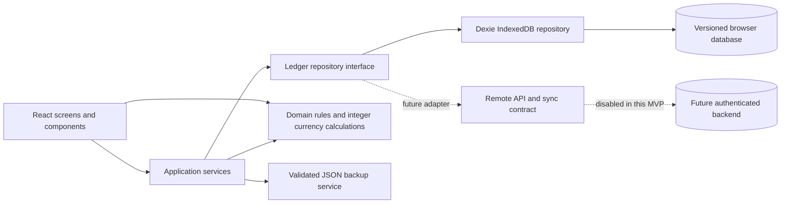

# Ledgerly

Ledgerly is a local-first sales and inventory workspace for small retailers. The app runs in a browser with no backend, API key, or account. Products, invoices, stock movements, purchases, payments, contacts, and settings live in IndexedDB on the current browser profile.

## Start on Windows

Requirements: Node.js 20 LTS or newer and npm.

```powershell
cd D:\coding\ledgerly-app
npm install
npm run dev
```

Open the local URL printed by Vite. To check the project and make a production bundle:

```powershell
npm run typecheck
npm test
npm run build
npm run preview
```

## What works

- Sales with line items, discounts, optional tax, payment status, stock deduction, invoice history, and a print-friendly receipt.
- Product catalogue with SKU, cost, price, stock, reorder thresholds, archive, and reasoned stock adjustments.
- Supplier purchases with draft, receive, cancel, payment, and duplicate-receipt protection.
- Customer and supplier contacts, transaction history, derived balances, and payment recording.
- Dashboard and reports calculated from stored local records, with sales CSV export.
- A deterministic, rule-based assistant that answers a defined set of questions from local records.
- Versioned JSON backup export, schema and size validation, preview, and confirmed restore.
- Demo records on first run, offline-ready app shell, and responsive layouts.

## Architecture



UI components call `LedgerService`; they do not use IndexedDB directly. The Dexie repository owns atomic business transactions. Domain calculations use integer paise and do not depend on React. See [Architecture](docs/ARCHITECTURE.md), [Domain model](docs/DOMAIN_MODEL.md), and [API contract](docs/API_CONTRACT.md).

## Local data, backups, and privacy

Ledgerly stores data in the browser's IndexedDB for this origin and browser profile. It works offline after its static app files have been cached, but a browser profile reset or storage cleanup can remove local records. Export periodic backups and keep copies somewhere safe. JSON backups are not encrypted. The MVP does not provide authentication, authorization, encrypted local storage, remote backup, or multi-user access.

The service worker caches the app shell and public static files only. Business records remain in IndexedDB and are never placed in a shared HTTP cache. Remote synchronization and external AI calls are not implemented. `.env.example` contains only a public future API base URL.

## Demo data

The first run opens a clearly labeled demo workspace. Use **Settings & backup → Reset demo** to restore the original sample records after confirmation. Restoring a backup replaces the current workspace only after validation, preview, and explicit confirmation.

## Project structure

- `src/domain/` — validated entities, invariants, money, and balances.
- `src/application/` — use cases, repository ports, reporting queries, and backup validation.
- `src/infrastructure/local/` — Dexie database, migrations, demo seed, and atomic repository implementation.
- `src/infrastructure/remote/` — typed HTTP and sync extension contracts; not enabled.
- `src/features/` — focused screen modules for each workflow.
- `src/components/` — shared interface and feedback components.
- `docs/` — architecture, domain, API, sync, security, and testing notes.
- `tests/` — domain and IndexedDB workflow tests.

## Current boundaries

This MVP is a single-browser local workspace, not a hosted accounting service. Gross profit is estimated from the item cost snapshot saved on each sale and excludes operating expenses, returns, and other accounting adjustments. Inventory value uses the current product cost. The remote API and sync contracts are documented but inactive. Browser persistence is not a backup strategy; export and store backups separately.

## Roadmap

1. Add authenticated server API and tenant-level authorization.
2. Add a durable sync outbox, idempotent server transactions, retry policy, and visible conflict resolution.
3. Add tested remote backup and recovery procedures.
4. Add accounting workflows for returns, expenses, tax filings, and reconciliation with qualified domain review.

See [Security](docs/SECURITY.md), [Sync strategy](docs/SYNC_STRATEGY.md), and [Testing](docs/TESTING.md) for limitations and verification details.
