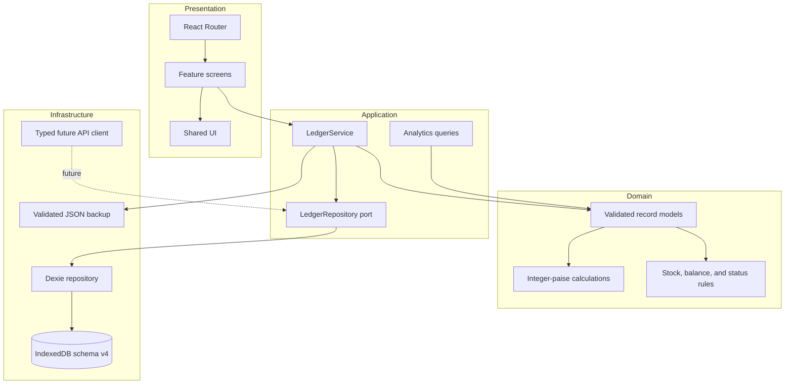

# Architecture

## Module boundaries

`LedgerProvider` composes one `LedgerService` with `DexieLedgerRepository`. It loads a snapshot and subscribes to repository mutations. Screens work with the service and snapshot; the repository is the only layer that reads or writes Dexie tables.

## Persistence and transactions

The database is named `LedgerlyLocal`. Version 1 creates the domain tables, version 2 ensures a business settings record exists, version 3 reconciles on-hand quantities against recorded stock movements with a dated stock-count adjustment, and version 4 adds an optional customer address field. The v3 migration preserves each current quantity; it does not reconstruct missing historical movements. The v4 migration supplies a blank address for existing customers. Records use stable UUID-based string identifiers. Financial values are stored as integer paise.

These workflows use a single IndexedDB read/write transaction:

- Sale: validates available stock, calculates totals from saved product price/cost snapshots, writes the sale, items, payment, stock decrements, movement history, operation key, and audit event. A new checkout customer and their audit event are committed in the same transaction; contact details are also frozen on the sale for its receipt.
- Purchase receipt: checks status and the receive operation key, increments each product, writes stock movements, updates status, and records an audit event.
- Import/reset: clears and restores all data inside one transaction. Validation happens before import starts.
- Stock adjustment and payments: validate the resulting quantity/balance before writing.

IndexedDB transactions provide atomicity within one browser database. They do not coordinate multiple devices or users. A future server must enforce these invariants with server-side database transactions and idempotency constraints.

## Error handling

Repository errors are returned to the calling screen for a readable toast/form message. Database initialization failures show a blocking recovery message and do not clear the database. Quota and browser storage errors are surfaced. Import parsing and validation happen before the active records are touched.

## Remote boundary

`LedgerRepository` is the application port. `ApiClient`, request/response contracts, error normalization, and `.env.example` define a future service boundary. The app intentionally composes the local repository only. Setting a base URL does not enable cloud sync.
