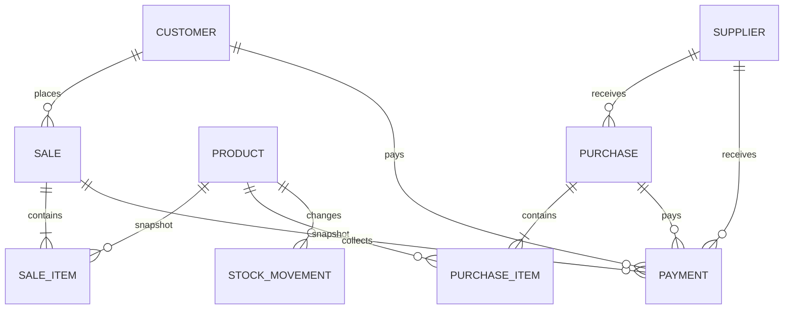

# Domain model

All record identifiers are stable strings generated from UUIDs (or deterministic IDs for the seeded walkthrough). Timestamps are ISO 8601 UTC strings. Money fields end in `Minor` and are integer paise. Quantities in this MVP are whole units.

## Relationships

## Records

- **Product**: SKU, category, unit, cost and selling price, current quantity, reorder point, archive status, and timestamps.
- **Customer / Supplier**: name, optional address, phone/email/notes, archive status, and timestamps. Balances are derived from transactions and payments.
- **Sale**: immutable invoice header with customer name and contact snapshot, subtotal, discount, tax, total, creation time, and idempotency key.
- **SaleItem**: product name/SKU, unit cost and price snapshots, quantity, line discount/tax, and total. This preserves a readable invoice after product edits or archive.
- **Purchase / PurchaseItem**: supplier snapshot, draft/received/cancelled state, item quantities/costs, and received time.
- **Payment**: direction, party, amount, method, optional sale/purchase allocation, idempotency key, timestamp, and note.
- **StockMovement**: signed quantity change with product snapshot, source, source record, reason, and timestamp.
- **AuditEvent**: concise history for important changes. It is local and is not tamper-proof.
- **BusinessSettings**: INR defaults, tax/reorder preferences, business profile, theme, and demo-workspace marker.

## Invariants

1. Normal sales reject archived products and insufficient stock.
2. Sale totals are recalculated from current catalogue prices and frozen into item snapshots; the sale header is not independently edited.
3. Product stock cannot go below zero or exceed the safe integer range. Every stock change has a movement record; non-sale/non-purchase adjustments require a reason.
4. Draft and cancelled purchases do not affect stock. Receipt is applied once, guarded by status and an operation key.
5. Customer receivables equal customer-linked sales less recorded incoming payments. Supplier payables equal received purchase totals less recorded outgoing payments.
6. Payment cannot exceed the outstanding balance. A party payment is allocated to oldest open invoices/purchases.
7. Archived people and products remain visible through transaction snapshots.
8. An operation key prevents a repeated financial submission from creating another record.

The current demo includes opening stock movements so its displayed quantities reconcile with its history. The database v3 migration adds a current stock-count adjustment for older records where movement history did not reconcile; it preserves on-hand quantities and does not recreate the original historical sequence. Database v4 adds blank addresses to existing customer records.

Gross profit is estimated as item revenue after discounts less frozen item costs. Tax is displayed separately and is not part of sales revenue. This is an operational estimate, not a complete accounting statement.
